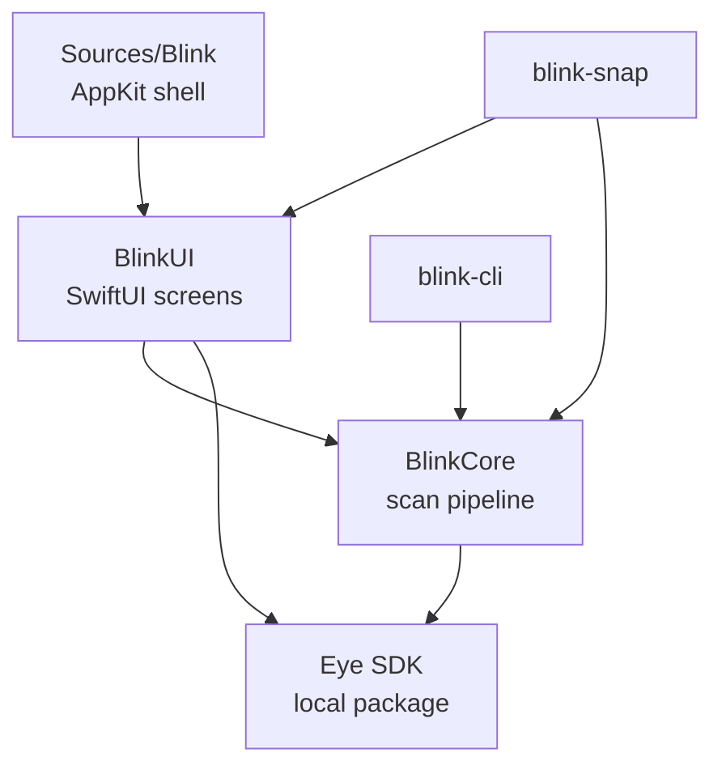

# Blink

A local, on-device photo rescue tool for macOS. Point it at a folder of photos and it does three things:

- groups near-identical shots into one moment and picks the frame where nobody blinked
- sweeps screenshots, receipts, documents and whiteboards into a junk drawer
- ranks your best photos of the year by aesthetic score

No account, no upload, no API key. The model runs on the machine.

## Contents

- [Why this exists](#why-this-exists)
- [The three screens](#the-three-screens)
- [Install and run](#install-and-run)
- [How it works](#how-it-works)
- [Architecture](#architecture)
- [Code walkthrough](#code-walkthrough)
- [Technologies](#technologies)
- [Measured numbers](#measured-numbers)
- [Project layout](#project-layout)
- [Fork it and run it locally](#fork-it-and-run-it-locally)
- [Contributing](#contributing)
- [Features worth adding](#features-worth-adding)
- [Things that will bite you](#things-that-will-bite-you)
- [Credits](#credits)

## Why this exists

Every burst of photos has one good frame. Finding it means opening six near-identical images and squinting at who blinked, which nobody does. So the bad frame stays in the album and gets posted, or the whole burst sits there forever.

The usual fix is a cloud service that wants your library. Blink takes the other path: a 49 MB vision model runs locally, and the whole decision happens on the Mac.

It is built on [Desert Ant Labs' Eye](https://github.com/Desert-Ant-Labs/desert-ant-core) model, which is the useful part. Eye returns per-face attributes: eyes closed, looking at camera, smiling, face quality, plus a keeper score, an aesthetic score, content tags, and duplicate grouping.

## The three screens

### Moments

Bursts and near-duplicates collapse into a single card. Blink keeps the frame with the highest keeper score and shows you what it beat, including how many people had their eyes shut in each losing frame.


### Junk Drawer

Screenshots, receipts, documents, whiteboards, menus, maps, charts and test shots get pulled out with Eye's confidence printed next to each one. Real photos stay in the library even when they are slightly soft, because quality failures are not clutter.


### Best Of

Top 10, 30, 50 or 100 photos ranked by aesthetic score, with the technical score and face count visible so the ranking is not a black box. Screenshots, documents and flagged content are excluded before ranking.


## Install and run

### From the zip

    unzip blink-mac.zip -d blink
    cd blink
    ./install.sh
    open Blink.app --args "$PWD/sample"

`install.sh` stages the model weights in `~/Library/Caches/desert-ant-models`, clears the quarantine flag, and prints the app path. First launch may need right click, Open, since the app is ad-hoc signed.

### From source

    git clone --depth 1 https://github.com/Desert-Ant-Labs/desert-ant-core.git sdk
    swift build -c release --product Blink
    swift build -c release --product blink-cli
    swift build -c release --product blink-snap

Requires macOS 14 or later and Swift 6.1 Command Line Tools. The package is pinned to the SDK as a local path dependency in `sdk/`.

### Command line

    ./.build/release/blink-cli fixtures/mixed --best 10 --json /tmp/out.json

    Blink scan · mixed
    13 photos · 0 moments · 0 bursts with a blink · 3 clutter · 13 from cache · 0.4s

    JUNK DRAWER  (top 15)
      1.00  screenshot_settings.jpg  [Screenshot 1.00, Forgettable 0.83]
      0.92  whiteboard_sketch.jpg    [Screenshot 0.92, Low content 0.53]
      0.71  receipt_coffee.jpg       [Letter 0.71, Screenshot 0.62]

    ./.build/release/blink-snap fixtures/mixed /tmp/blink.png junk

`blink-snap` renders the real interface offscreen to a PNG in the given mode (`moments`, `junk`, `best`), which is how the interface gets tested without screen recording permission.

## How it works

```
folder  ->  enumerate  ->  cache lookup  ->  Eye analyze (3 at a time)
                                                 |
                                   Analysis per photo (faces, tags, scores)
                                                 |
             +-----------------------------------+-----------------------------------+
             |                                   |                                   |
      Eye.duplicates(in:dates:)          Junk.isJunk(a)                     beauty ranking
             |                                   |                                   |
      Eye.best(of:) per group            sorted by tag confidence            top N, minus junk
             |
       Moments (keeper + losers)
```

The second half is pure data: no model calls, no I/O. That is deliberate, because it means changing the top N, re-picking a keeper, or re-sorting is instant, and the CLI and the GUI cannot drift apart.

## Architecture

Five targets, two libraries, three executables. The reason for the split is verification: the pipeline is testable headlessly, and the interface is renderable without a screen.



ASCII version, for anywhere mermaid is not rendered:

```
Blink (AppKit)  --->  BlinkUI (SwiftUI)  --->  BlinkCore (pipeline)
                           ^                        |
                           |                        v
blink-snap  ----------------+------------------>  Eye SDK
blink-cli  ------------------------------------->  Eye SDK
```

Layering rules that hold in the code:

- `BlinkCore` imports `Eye` and `Foundation` only. No SwiftUI, no AppKit.
- `BlinkUI` owns all view state and the folder picker.
- `Blink` is 100 lines: a window, a menu, and a diagnostic hook.
- `blink-cli` and `blink-snap` are thin argument parsers over the same APIs.

## Code walkthrough

### The package manifest

Path dependencies need an explicit package identity, otherwise SwiftPM resolves the folder name `sdk` and the products cannot be found. Every target builds in Swift language mode 5 because the SDK's own sources are not strict-concurrency clean.

```swift
let package = Package(
    name: "Blink",
    platforms: [.macOS(.v14)],
    products: [
        .executable(name: "Blink", targets: ["Blink"]),
        .executable(name: "blink-cli", targets: ["BlinkCLI"]),
        .executable(name: "blink-snap", targets: ["BlinkSnap"]),
        .library(name: "BlinkCore", targets: ["BlinkCore"]),
        .library(name: "BlinkUI", targets: ["BlinkUI"]),
    ],
    dependencies: [
        .package(name: "DesertAnt", path: "sdk"),
    ],
    targets: [
        .target(
            name: "BlinkCore",
            dependencies: [.product(name: "Eye", package: "DesertAnt")],
            path: "Sources/BlinkCore",
            swiftSettings: [.swiftLanguageMode(.v5)]),
    ]
)
```

### Bounded concurrency over the model

One actor owns the model, three photos are in flight at a time. The task group pulls the next index as each result lands, so memory stays flat on a 5,000 photo folder instead of spiking.

```swift
await withTaskGroup(of: (Int, Analysis?, String?).self) { group in
    var next = 0
    let limit = 3
    func add(_ idx: Int) {
        let target = items[idx]
        group.addTask {
            do { return (idx, try await EyeEngine.shared.analyze(target.url), nil) }
            catch { return (idx, nil, error.localizedDescription) }
        }
    }
    while next < min(limit, total) { add(missing[next]); next += 1 }
    for await r in group {
        items[r.0].analysis = r.1
        if let a = r.1 { AnalyzeCache.save(a, for: items[r.0].url) }
        if next < total { add(missing[next]); next += 1 }
    }
}
```

### Grouping and picking

Eye does the hard part. `duplicates(in:dates:)` returns index groups, `best(of:)` returns the index of the frame to keep. Blink only decides presentation.

```swift
let groups = Eye.duplicates(in: analyses, dates: dates)
for g in groups where g.count >= 2 {
    let items = g.map { analyzed[$0] }
    let pick = Eye.best(of: g.map { analyses[$0] }) ?? 0
    moments.append(Moment(id: items[0].id, items: items, pickIndex: pick))
}
```

### The junk classifier, and the bug that shaped it

The first version treated every junk-ish tag the same. It filed a gala photo under "identity paper" at 0.70 because the photo had name cards in it. `identityDocument`, `lowContent`, `forgettable`, `technicalFlaw` and `blurry` all fire on real photographs, so they needed a much higher bar and a different consequence.

```swift
/// Tags that are near-certain when Eye is confident at all.
public static let hardTags: Set<Tag> = [
    .screenshot, .photoOfScreen, .receipt, .document, .idCard, .whiteboard,
    .chartOrSlide, .menu, .map, .handwriting, .letterMessage, .testOrDuplicateShot,
]

/// Tags that fire on real photos too, so they need a much higher bar.
public static let softTags: Set<Tag> = [
    .identityDocument, .lowContent, .forgettable, .technicalFlaw, .unusable,
    .badFraming, .blurry,
]

public static func isJunk(_ a: Analysis?) -> Bool {
    guard let a else { return false }
    if a.kind == .screenshot || a.kind == .document || a.kind == .receipt { return true }
    if let hard = hardTags.compactMap({ a.confidence($0) }).max(), hard >= 0.55 { return true }
    return false
}
```

Soft tags do not create junk. They only remove a photo from Best Of. A slightly blurry portrait stays in the album and simply loses the ranking, which is what a person would do.

### The app shell

SwiftUI's `WindowGroup` never produced a window in this environment: the process launched, stayed alive, and `NSApp.windows` was empty. The shell is now driven by hand, which is 20 lines longer and completely deterministic.

```swift
@main
enum BlinkMain {
    @MainActor
    static func main() {
        let app = NSApplication.shared
        app.delegate = AppDelegate()
        app.setActivationPolicy(.regular)
        app.mainMenu = MainMenu.build()   // Cmd O, Cmd Q
        app.run()
    }
}

// inside AppDelegate
let win = NSWindow(
    contentRect: NSRect(x: 0, y: 0, width: 1280, height: 830),
    styleMask: [.titled, .closable, .miniaturizable, .resizable, .fullSizeContentView],
    backing: .buffered, defer: false)
win.titlebarAppearsTransparent = true
win.titleVisibility = .hidden
win.contentView = NSHostingView(rootView: ContentView())
win.makeKeyAndOrderFront(nil)
```

### Rendering the interface offscreen

`ImageRenderer` needs the real view tree, but `LazyVGrid` inside a `ScrollView` renders empty when there is no viewport. A flag switches the root to a plain container when rendering, and the snapshot binary drives the same `Store` the app uses.

```swift
RenderFlag.offscreen = true
let store = Store()
store.open(folder)
while store.scanning || store.photos.isEmpty {
    try? await Task.sleep(nanoseconds: 300_000_000)
}
store.mode = mode
let renderer = ImageRenderer(content: ContentView(store: store).frame(width: 1440, height: 900))
renderer.scale = 2
```

## Technologies

- **Swift 6.1**, no Xcode, Command Line Tools only
- **SwiftPM** with a local path dependency for the SDK
- **SwiftUI** for every screen, **AppKit** for the window, menu and folder picker
- **Desert Ant Labs Eye** for analysis, duplicate grouping, keeper ranking and crops
- **actor** isolation around the model, `TaskGroup` for bounded parallelism
- **ImageRenderer** for offscreen interface verification
- **NSCache** for thumbnails, keyed by path and pixel bucket
- **JSON file cache** in `~/Library/Application Support/Blink/analyses`

## Measured numbers

Numbers from this machine, M1 Pro, on fixture folders:

- 2 photos, cold: 69.7s total, almost all of it model load
- 9 photos, cold: 139.1s, so about 14s per photo after load
- 13 photos with 3 clutter items: junk drawer returned exactly 3, screenshot 1.00, whiteboard 0.92, receipt 0.71, zero false positives on people photos
- warm rerun on cached analyses: seconds, no model calls

The honest takeaway: first pass is slow, roughly two hours per 500 photos. Cached scans are instant. A progress bar with an ETA and a resumable scan are the next things worth building.

## Project layout

```
Package.swift              five targets, one local dependency
Sources/BlinkCore/
  Model.swift              PhotoItem, Moment, BlinkMode, Facts, Junk classifier
  Scanner.swift            enumerate, cache, analyze, group, rank
Sources/BlinkUI/
  Store.swift              @MainActor observable state, folder picker
  Views.swift              theme, thumbnail cache, all three screens
  Snapshot.swift           offscreen ImageRenderer helper
Sources/Blink/
  BlinkApp.swift           NSApplication + NSWindow + menu
Sources/BlinkCLI/main.swift   folder in, JSON out
Sources/BlinkSnap/main.swift  folder in, PNG out
fixtures/                  burst, clutter, mixed, people, junk, screens
docs/img/                  interface snapshots
```

## Fork it and run it locally

1. Fork the repository.
2. Clone the SDK next to your checkout, because it is not vendored:

        git clone --depth 1 https://github.com/Desert-Ant-Labs/desert-ant-core.git sdk

3. If your toolchain is older than the SDK's manifest, patch the tools version:

        sed -i '' '1s/6.2/6.1/' sdk/Package.swift

4. Build once, cold, and give it time. The first build compiles the Eye stack and takes about ten minutes.

        swift build -c release --product blink-cli

   If dependency resolution fails with `already exists in file system`, purge the repository cache and retry:

        rm -rf .build/repositories

5. Prove the pipeline before touching the UI:

        ./.build/release/blink-cli fixtures/mixed --best 10 --json /tmp/out.json

6. Prove the UI without a screenshot:

        ./.build/release/blink-snap fixtures/mixed /tmp/blink.png junk

Keep `fixtures/mixed` small. It is the fastest honest test: three clutter items and ten photographs, so both a false positive and a false negative are visible immediately.

## Contributing

Pull requests are welcome. What makes a change easy to accept:

- **Proof.** A CLI run or a `blink-snap` PNG showing the before and after, not a description.
- **Small surface.** One behavior per PR. The classifier, the grouping and the UI are separate concerns in separate files for a reason.
- **No network.** Nothing in the app may phone home. The only network use allowed is the SDK's one-time weight download.
- **No new dependencies** without a reason that survives review.

Before you open a PR:

    swift build -c release --product Blink
    swift build -c release --product blink-cli
    swift build -c release --product blink-snap
    ./.build/release/blink-cli fixtures/mixed --best 10

Areas where help is genuinely useful: the scan is serial per folder and does not resume, there are no tests, and the classifier thresholds were tuned on 22 fixture images, which is not a dataset.

## Features worth adding

**High value, low risk**

- Resumable scans, so closing the app mid-library does not throw away progress
- A real ETA, using the rolling average of the last 20 photos
- Keyboard triage in Moments: left and right to walk the burst, space to keep
- A contact sheet per moment, so you can see all six frames of a burst
- Export the keeper set to a folder, or to Photos

**Medium**

- Duplicate folder sweep across two libraries using Eye's similarity
- Receipt mode that crops the receipt and stores the recognized text
- An album browser on top of `~/Pictures/Photos Library.photoslibrary`, which has no indexed originals today (files are extensionless), so it needs its own enumerator
- Menu bar app that watches a folder and rescans on change
- Side by side comparisons for bursts that differ in focus, using the technical score

**Bigger**

- iOS port with the Photos framework, same engine, same three screens
- A quality pass that ranks technical flaws separately from aesthetic score, so a sharp boring photo and a soft beautiful one are not merged
- Photo of screen detection for photos of monitors that are not screenshots
- Batch export with the original metadata preserved

## Things that will bite you

- The Eye SDK is source-available and free under 100k monthly active installs. Licensing counts installs, not calls.
- Model weights download on first use into `~/Library/Caches/desert-ant-models`. Bundling them is what makes the zip work offline.
- Photos library originals have no file extensions, so an extension filter finds nothing there.
- Swift 6 strict concurrency will reject the SDK. Language mode 5 on every target is not laziness, it is the compatibility boundary.
- `ImageRenderer` in a running app hangs waiting for a run loop. It works in a separate accessory process, which is why `blink-snap` exists.
- An ad-hoc signature means Gatekeeper asks once per machine. Notarizing requires a paid developer account and is not done.

## Credits

Built on [Desert Ant Labs](https://github.com/Desert-Ant-Labs/desert-ant-core) and their Eye model. Fixture photos come from Wikimedia Commons under their respective licenses, plus synthetic screenshots, receipts and whiteboards drawn for testing this classifier.